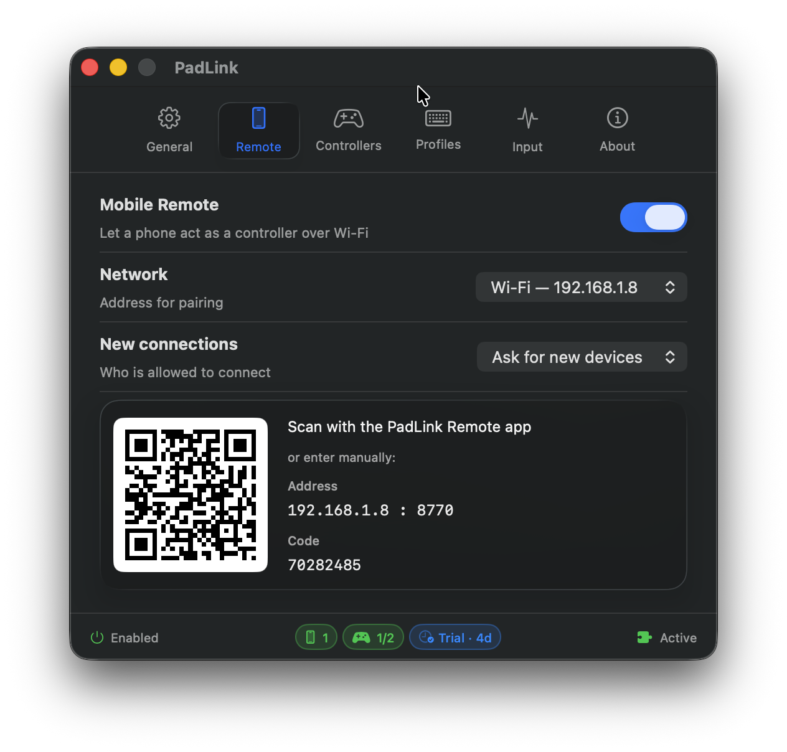
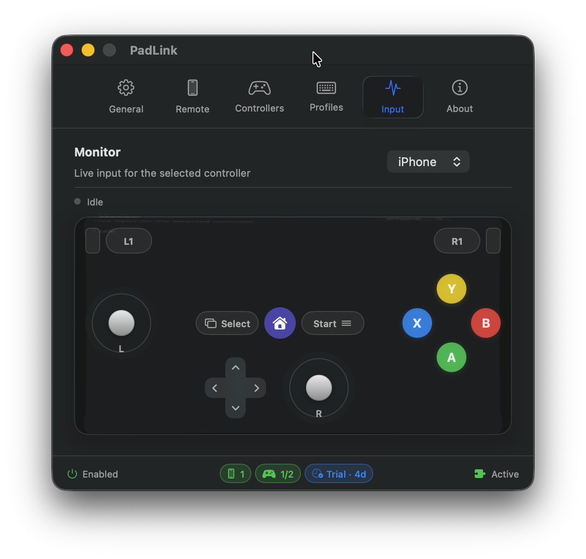
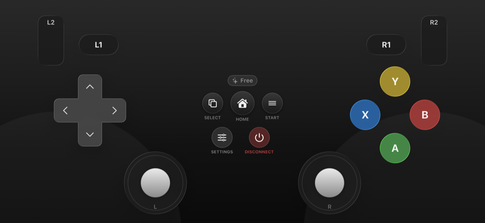
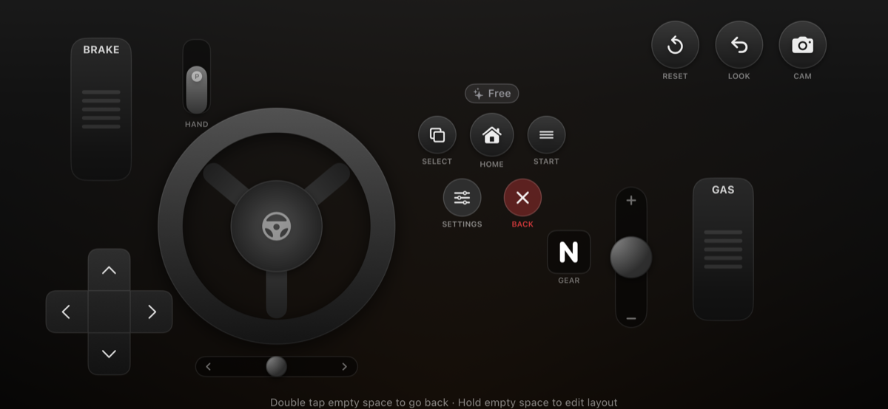

# PadLink

**Make game controllers your computer doesn't recognize work like they should — or use your
phone as one.**

Some USB/Bluetooth gamepads are perfectly valid HID devices, but their report descriptors
aren't on macOS's recognized list — so games ignore them. PadLink reads the controller
directly and re-presents it to the OS, the way Steam Input does, so your games finally see it.

No controller at all? **PadLink Remote** turns your phone into one over Wi-Fi — including a full
racing cockpit with a steering wheel, pedals, and a shifter.

> This is the **public community & downloads** hub for PadLink. Use it to **download the app**,
> **report bugs**, **request features**, and **request support for a new controller**. (The
> application source code is not hosted here.)

---

## ⬇️ Download

  
  &nbsp;&nbsp;
  

<a href="https://github.com/nimets-dev/PadLink-Community/releases/latest"><b>All downloads &amp; release notes →</b></a>

<b>📱 And the phone app — <i>PadLink Remote</i>, free:</b>

  
  &nbsp;&nbsp;
  

- 🖥️ **macOS** — **available now** (Apple Silicon + Intel, notarized by Apple). **Keyboard & mouse
  mode works today**; **virtual-gamepad mode is code-complete and awaiting Apple's DriverKit /
  Virtual-HID entitlement approval** before it lights up for everyone.
- 💻 **Windows** — **ready now** (Windows 10/11 — one installer for both Intel/AMD and ARM). Full
  **virtual Xbox 360 gamepad** *and* keyboard/mouse, driven by your phone via PadLink Remote.
- 📱 **PadLink Remote** — **out now on both stores**, free:
  **[App Store](https://apps.apple.com/app/id6794668210)** (iPhone, iOS 16+) and
  **[Google Play](https://play.google.com/store/apps/details?id=com.nimets.padlink.remote)**
  (Android 8+). It's a companion to the desktop app — install PadLink on your computer first.

💡 <b>Windows may say the installer "isn't commonly downloaded" — here's why, and what to click</b>

 

PadLink is new, and Windows hasn't seen enough downloads yet to have built a reputation for it.
That's all this warning means. It is **not** a virus alert — it's a "we haven't met this file
before" notice that every small app gets until enough people have installed it.

To continue past it:

- **Edge** — click the **⋯** next to the download → **Keep** → **Keep anyway**
- **Chrome** — click the **▾** next to the download → **Keep**
- If a blue **"Windows protected your PC"** screen appears when you run the installer, click
  **More info** → **Run anyway**

Want to check the file yourself? GitHub publishes a **SHA256** for every release asset; compare it
with `Get-FileHash .\PadLink-win-Setup.exe` after downloading.

_⭐ Star or watch this repo to catch every update. Both installers auto-update themselves once installed._

---

## What it does

PadLink takes your input — a physical controller, or your phone via **PadLink Remote** — and
routes it through one of two output modes:

- **Keyboard & Mouse mode** — maps controller buttons/sticks to keystrokes and mouse movement.
  Works with any game or app. On macOS it needs only the Accessibility permission — no driver.
- **Gamepad mode** — presents a standard virtual controller to the OS so games see a real
  gamepad (with full stick/trigger support and on-screen glyphs).

Each connected controller is configured independently — its own mode, its own mapping profile,
its own name — and PadLink remembers it across reconnects.

> **On Windows**, PadLink is **phone-driven**: PadLink Remote is the input source, presented to
> games as a real virtual gamepad or as keyboard/mouse. Windows already recognizes most USB pads
> natively, so it doesn't need the physical-controller rescue that macOS does.

The **free tier** covers the essentials — **1 controller** at a time, both output modes, all
mapping profiles, and the PadLink Remote touch gamepad (ad-supported). **PadLink Pro** raises that
to **4 controllers** at once and adds the **Car Driving** cockpit and an ad-free PadLink Remote.

**Want to try Pro first?** There's an opt-in **7-day free trial** you start from inside the app —
no card, no sign-up. It unlocks **everything Pro does, including the Car Driving cockpit and the
ad-free remote**; only the controller count is lower (**2** during the trial, vs 4 on Pro). See the
in-app About / Plan screen for details.

---

## 📸 Screenshots

### macOS app

  
  &nbsp;
  

### PadLink Remote (iOS)

  
  &nbsp;
  

---

## 📱 PadLink Remote — use your phone as a controller

No physical gamepad? **PadLink Remote** (iPhone & Android) turns your phone into a wireless controller. It
shows an on-screen touch gamepad — two sticks, an 8-way D-pad, face buttons, shoulders, and
travel-based triggers, plus a touchpad mouse mode — and sends your input to the Mac over your
local network, where it drives the exact same output as a physical pad (gamepad **or**
keyboard/mouse mode).

- **Multiple layouts** — a standard **gamepad** layout, plus a **Car Driving** cockpit for racing
  games: a rotating steering wheel (or optional tilt/motion steering), gas and brake pedals, a
  sequential gear shifter, and a handbrake. Switch to the surface that fits what you're playing.
  _(The gamepad layout is free. The Car Driving cockpit needs **Pro** — or the **7-day free
  trial**, which includes it.)_
- **Switch surfaces mid-game** — hold one button to flip between the gamepad and the cockpit, so
  you have a familiar pad for the menus a game drops you into between races.
- **Driving button profiles** — the cockpit's buttons aren't fixed. Pick a control-style preset or
  build your own, and every control shows the button it actually sends, labelled the way your game
  uses it (DRIFT, NITRO, …) instead of a caption that lies.
- **Pair in seconds** — scan a QR code or enter the host's IP; reconnect to known hosts with one tap.
- **Feels real** — haptic vibration (including live trigger rumble) and optional click sounds.
- **Make it yours** — drag, resize, and restyle the on-screen controls with the built-in layout editor.
- **Stays awake** — keeps the phone screen on while you play.

**Get PadLink Remote — it's free and out now:**
**[⬇️ App Store (iPhone)](https://apps.apple.com/app/id6794668210)** ·
**[⬇️ Google Play (Android)](https://play.google.com/store/apps/details?id=com.nimets.padlink.remote)**

Install it, open PadLink on your computer, and pair. Both versions are built at feature parity, so
it doesn't matter which phone you bring.

---

## 🎮 Supported controllers

| Controller | USB VID:PID | Status |
|------------|-------------|--------|
| SHANWAN "Android Gamepad" | `0x2563:0x0526` | ✅ Supported |
| "PS3/PC Gamepad" clone | `0x2563:0x0575` | ✅ Supported |

_This list is for **macOS**, where PadLink reads the pad directly. On Windows, controllers are
handled by the OS — PadLink Remote (your phone) is the input source there._

**Don't see your controller?** PadLink can likely support it — open a
**[New Controller Support request](https://github.com/nimets-dev/PadLink-Community/issues/new?template=controller_support.yml)**
and include the details the form asks for (we use them to add a decode profile for your pad).

---

## 🗺️ Roadmap

### ✅ Built & shipping
- 🖥️ macOS app — menu-bar agent & dashboard (keyboard & mouse mode; gamepad mode pending Apple, see below)
- 💻 Windows app — virtual Xbox 360 gamepad + keyboard/mouse, tray app, light/dark themes, one-click driver install
- ⌨️ Keyboard & Mouse mode
- 🎮 Up to 4 controllers at once, each with its own mode and reusable mapping profiles
- 📱 PadLink Remote — **on the [App Store](https://apps.apple.com/app/id6794668210) and
  [Google Play](https://play.google.com/store/apps/details?id=com.nimets.padlink.remote)** — Gamepad
  & Car Driving layouts, iPhone and Android at feature parity
- 🏎️ Driving button profiles — switchable button maps + honest control labels for the cockpit
- 🔀 Fast surface switch — flip Gamepad ⇄ Car Driving without leaving the game
- 📳 Haptics & trigger rumble
- ✏️ Drag-to-edit layout editor & QR / IP pairing
- 🔐 Connection approval — approve, deny, or block any phone that asks to connect
- 🔔 Connect notifications & 🚀 launch at login
- 🔄 Automatic updates on macOS & Windows
- 💎 PadLink Pro

### 🔜 In progress — next out the door
- 🕹️ **Virtual Gamepad mode on macOS** — code-complete; waiting on Apple's DriverKit / Virtual-HID
  entitlement approval before it ships. Keyboard & mouse mode already works on macOS today.

### 🔭 Planned / future
- ➕ More controllers
- ✈️ More Remote layouts & skins (incl. an **Airplane** type)
- 🎨 Purchasable wheel & controller skins
- 📡 Zero-config pairing (no IP or QR needed)
- 🌍 Play over the internet, not just your local network

> Timelines aren't promises. Want something prioritized?
> [Request a feature](https://github.com/nimets-dev/PadLink-Community/issues/new?template=feature_request.yml)
> or join the [Discussions](https://github.com/nimets-dev/PadLink-Community/discussions).

---

## 💬 Community & support

- **🐛 Found a bug?** → [Open a bug report](https://github.com/nimets-dev/PadLink-Community/issues/new?template=bug_report.yml)
- **💡 Want a feature?** → [Request a feature](https://github.com/nimets-dev/PadLink-Community/issues/new?template=feature_request.yml)
- **🎮 New controller?** → [Request controller support](https://github.com/nimets-dev/PadLink-Community/issues/new?template=controller_support.yml)
- **❓ Questions & ideas?** → [Discussions](https://github.com/nimets-dev/PadLink-Community/discussions)

Faster, direct help:

- **Telegram:** [@nimets_support](https://t.me/nimets_support)
- **Email:** [support@nimets.com](mailto:support@nimets.com)
- **Website:** [padlink.nimets.com](https://padlink.nimets.com)

---

## License

PadLink is proprietary software. See [EULA.md](EULA.md) for the end-user license agreement.
Content in this repository (issue templates, docs) is provided for community use with PadLink.
